# DADU — Entity-Relationship Diagram (ERD) & Data Model

> **Dokumen Model Data Cloud Firestore**
> Menggambarkan struktur hierarki multi-tenant, subcollection terisolasi per guru/user, kamus data kanonikal, serta relasi logis dan fisik antar entitas.

---

## 1. 🗺 Diagram ERD Domain (Mermaid)

Model relasi logis bisnis aplikasi DADU berpusat pada entitas pengguna terisolasi (`USER_PROFILE`). Seluruh entitas transaksional berada di bawah ruang lingkup tahun ajaran dan rombongan belajar (rombel).

```mermaid
erDiagram
    %% Top-Level / Tenant Ownership
    USER_PROFILE ||--o{ ACADEMIC_YEAR : "owns"
    USER_PROFILE ||--o{ CLASS_ITEM : "manages"
    USER_PROFILE ||--o{ SUBJECT : "teaches"
    USER_PROFILE ||--o{ STUDENT : "registers"
    USER_PROFILE ||--o{ TEACHING_ASSIGNMENT : "assigns"
    USER_PROFILE ||--o{ STUDENT_NOTE : "records"
    USER_PROFILE ||--o{ SETTINGS : "configures"
    USER_PROFILE ||--o{ STUDENT_CUSTOM_FIELD : "defines"
    USER_PROFILE ||--o{ FEEDBACK : "submits"
    USER_PROFILE ||--o{ SHARED_REPORT : "publishes"

    %% Subcollection Relationships
    ACADEMIC_YEAR ||--o{ ENROLLMENT : "scopes"
    ACADEMIC_YEAR ||--o{ TEACHING_ASSIGNMENT : "schedules"
    ACADEMIC_YEAR ||--o{ CLASS_SCHEDULE : "schedules"
    ACADEMIC_YEAR ||--o{ STUDENT_NOTE : "scopes"
    ACADEMIC_YEAR ||--o{ TEACHER_ATTENDANCE_RECORD : "scopes"

    CLASS_ITEM ||--o{ ENROLLMENT : "contains"
    CLASS_ITEM ||--o{ TEACHING_ASSIGNMENT : "assigned_to"
    CLASS_ITEM ||--o{ CLASS_SCHEDULE : "has"
    CLASS_ITEM ||--o{ DAILY_ATTENDANCE_SESSION : "holds"
    CLASS_ITEM ||--o{ STUDENT_NOTE : "logs_for"
    CLASS_ITEM ||--o{ TEACHER_ATTENDANCE_RECORD : "monitors"
    CLASS_ITEM ||--o{ TEACHER_MONTHLY_ATTENDANCE : "summarizes"

    SUBJECT ||--o{ TEACHING_ASSIGNMENT : "teaches"
    SUBJECT ||--o{ TEACHER_ATTENDANCE_RECORD : "conducted_for"

    STUDENT ||--o{ ENROLLMENT : "enrolled_in"
    STUDENT ||--o{ ATTENDANCE_RECORD : "marked_for"
    STUDENT ||--o{ DAILY_ATTENDANCE_RECORD : "marked_for"
    STUDENT ||--o{ SCORE : "receives"
    STUDENT ||--o{ STUDENT_NOTE : "referenced_in"

    TEACHING_ASSIGNMENT ||--o{ MEETING : "conducts"
    TEACHING_ASSIGNMENT ||--o{ ATTENDANCE_RECORD : "records"
    TEACHING_ASSIGNMENT ||--o{ ASSESSMENT_ITEM : "evaluates"

    %% Decoupled Lifecycle: Meeting optional for AttendanceRecord
    MEETING |o--o{ ATTENDANCE_RECORD : "tracks (optional)"

    DAILY_ATTENDANCE_SESSION ||--o{ DAILY_ATTENDANCE_RECORD : "logs"

    ASSESSMENT_ITEM ||--o{ SCORE : "grades"

    %% Entity Attributes & Types
    USER_PROFILE {
        string id PK "Firebase Auth UID"
        string email
        string displayName "Nama lengkap / gelar guru"
        string role "TEACHER | ADMIN"
        string accountStatus "ACTIVE | INACTIVE | SUSPENDED"
        string defaultAcademicYearId FK
        string defaultSemester "GANJIL | GENAP"
        boolean isOnboarded
        string nip "NIP opsional"
        string nuptk "NUPTK opsional"
        string employmentStatus "PNS | PPPK | GTT | TETAP_YAYASAN | HONORER"
        timestamp createdAt
        timestamp updatedAt
    }

    ACADEMIC_YEAR {
        string id PK
        string label "Contoh: 2026/2027"
        number startYear
        number endYear
        string currentSemester "GANJIL | GENAP"
        boolean isActive
        boolean isArchived
        timestamp createdAt
        timestamp updatedAt
    }

    CLASS_ITEM {
        string id PK
        string academicYearId FK
        string name "Contoh: 7-A, 8-B"
        string gradeLevel "Contoh: 7 | 8 | 9 | 10"
        string major "Contoh: MIPA | IPS | Umum"
        string classTeacherId "UID guru wali kelas"
        string classTeacherName
        boolean isActive
        boolean isArchived
    }

    SUBJECT {
        string id PK
        string code "Contoh: MAT, ENG"
        string name "Contoh: Matematika"
        boolean isActive
        boolean isArchived
    }

    STUDENT {
        string id PK
        string fullName
        string nis
        string nisn
        string gender "L | P"
        string status "ACTIVE | INACTIVE | GRADUATED | TRANSFERRED"
        string nikSiswa
        string nikIbu
        string nkk
        boolean isArchived
        timestamp createdAt
        timestamp updatedAt
    }

    ENROLLMENT {
        string id PK
        string studentId FK
        string classId FK
        string academicYearId FK
        number rollNumber "Nomor urut presensi siswa"
        string status "ACTIVE | INACTIVE | TRANSFERRED | GRADUATED"
        string transferredToClassId FK "Audit trail mutasi kelas"
        string transferredFromClassId FK "Audit trail kelas asal"
        timestamp transferredAt
        timestamp relinkedAt "Audit trail identity re-link"
        string relinkReason
    }

    TEACHING_ASSIGNMENT {
        string id PK
        string academicYearId FK
        string semester "GANJIL | GENAP"
        string classId FK
        string subjectId FK
        string teacherId "UID guru pengampu"
        boolean isActive
        boolean isArchived
        string dayOfWeek "Metadata jadwal (e.g. Senin)"
        string timeSlot "Metadata jam (e.g. 07:30 - 09:00)"
    }

    MEETING {
        string id PK
        string teachingAssignmentId FK
        string classId FK
        string subjectId FK
        string academicYearId FK
        string semester "GANJIL | GENAP"
        number meetingNumber "Urutan pertemuan 1-N"
        string date "YYYY-MM-DD"
        string topic
        string status "DRAFT | SCHEDULED | COMPLETED | CANCELLED | SUBSTITUTE"
        string meetingType "CLASS | MADRASAH_ACTIVITY"
    }

    ATTENDANCE_RECORD {
        string id PK "Deterministik: ay_sem_class_date_ta_student"
        string studentId FK
        string teachingAssignmentId FK
        string meetingId FK "Nullable: opsional / soft-unlinked"
        number meetingNumber "Nullable: berpasangan dengan meetingId"
        string academicYearId FK
        string semester "GANJIL | GENAP"
        string classId FK
        string date "YYYY-MM-DD"
        string status "PRESENT | SICK | PERMITTED | ABSENT | DISPENSATION"
        string note "Catatan individual siswa"
    }

    DAILY_ATTENDANCE_SESSION {
        string id PK "Deterministik: ayId_classId_date"
        string classId FK
        string academicYearId FK
        string date "YYYY-MM-DD"
        string inputMethod "DIRECT | MANUAL_BOOK"
        number totalPresent
        number totalSick
        number totalPermit
        number totalAbsent
    }

    DAILY_ATTENDANCE_RECORD {
        string id PK "Deterministik: ayId_classId_date_studentId"
        string sessionId FK
        string classId FK
        string studentId FK
        string date "YYYY-MM-DD"
        string status "PRESENT | SICK | PERMITTED | ABSENT | DISPENSATION"
        string note
    }

    ASSESSMENT_ITEM {
        string id PK
        string teachingAssignmentId FK
        string classId FK
        string subjectId FK
        string academicYearId FK
        string semester "GANJIL | GENAP"
        string name "Contoh: Penilaian Harian 1"
        string category "ASSIGNMENT | QUIZ | PRACTICE | PROJECT | MIDTERM | FINAL | OTHER"
        string assessmentDate "YYYY-MM-DD"
        number maxScore "Default: 100"
        number weight "Bobot persentase"
        boolean isIncludedInFinalScore
    }

    SCORE {
        string id PK "Deterministik: assessmentItemId_studentId"
        string assessmentItemId FK
        string studentId FK
        number score "0 - 100"
        string note
    }

    STUDENT_NOTE {
        string id PK
        string studentId FK
        string classId FK
        string academicYearId FK
        string date "YYYY-MM-DD"
        string category "ACADEMIC | ATTENDANCE | ACHIEVEMENT | BEHAVIOR | ADMINISTRATIVE | DISCIPLINE | OTHER"
        string note "Teks utama catatan pembinaan"
        string actionPlan "Rencana tindak lanjut"
        string parentFollowUp "Tindak lanjut orang tua"
        boolean isImportant
    }

    TEACHER_ATTENDANCE_RECORD {
        string id PK "Deterministik: ay_sem_class_date_ta"
        string classId FK
        string academicYearId FK
        string semester "GANJIL | GENAP"
        string date "YYYY-MM-DD"
        string teachingAssignmentId FK
        string subjectId FK
        string teacherId "UID guru yang mengajar"
        string teacherName
        string status "HADIR | SAKIT | IZIN | ALPA | DINAS"
        string entryType "ROUTINE | SUBSTITUTE | SCHEDULE_SHIFT | MANUAL"
        boolean isSubstitute
    }

    TEACHER_MONTHLY_ATTENDANCE {
        string id PK "Deterministik: classId_ayId_sem_year_month"
        string classId FK
        string academicYearId FK
        string semester "GANJIL | GENAP"
        number year "Tahun kalender (e.g. 2026)"
        number month "Bulan 1-12"
        json items "TeacherMonthlyAttendanceItem[]"
    }

    STUDENT_CUSTOM_FIELD {
        string id PK
        string key "Contoh: kip | bloodType | previousSchool"
        string name "Contoh: KIP / PIP | Golongan Darah"
        string type "TEXT | NUMBER | SELECT | DATE"
        json options "Pilihan jika type SELECT"
        boolean showInTable
        boolean isActive
    }

    FEEDBACK {
        string id PK
        string userId FK
        string type "BUG | FEATURE | IMPROVEMENT | OTHER"
        string title
        string description
        string status "NEW | IN_PROGRESS | RESOLVED"
        string adminReply
    }

    SHARED_REPORT {
        string id PK "Unique Public Access Token"
        string userId FK
        string reportType "ATTENDANCE | JOURNAL | LEGGER"
        string title
        boolean hasPasscode
        string salt "PBKDF2 hex salt"
        string iv "AES-GCM hex IV"
        string encryptedPayload "Base64 ciphertext jika ber-passcode"
        boolean isRevoked
        number viewCount
        timestamp expiresAt
    }

    CLASS_SCHEDULE {
        string id PK "Deterministik: classId_ayId_semester"
        string classId FK
        string academicYearId FK
        string semester "GANJIL | GENAP"
        json items "ClassScheduleItem[]"
    }

    SETTINGS {
        string id PK "'school' | 'document' | 'attendance' | 'preferences'"
        string userId FK
    }
```



---

## 2. 🏛 Arsitektur Integritas Referensial Firestore (4-Tier Framework)

Sebagai database dokumen NoSQL terdistribusi, Cloud Firestore **tidak menyediakan declarative foreign key constraints, otomatisasi `ON DELETE CASCADE`, maupun join atomik lintas koleksi**. Aplikasi DADU mengelola referensi dan integritas relasional melalui kerangka kerja terkoordinasi 4 lapis:

```text
┌────────────────────────────────────────────────────────────────────────┐
│ 1. CONCEPTUAL / DOMAIN TIER                                            │
│    Relasi logis bisnis: Pertemuan menaungi Presensi Siswa              │
└───────────────────────────────────┬────────────────────────────────────┘
                                    │ diimplementasikan oleh
┌───────────────────────────────────▼────────────────────────────────────┐
│ 2. STORED ID REFERENCES TIER (Physical Documents)                      │
│    Field FK mandiri: meetingId, studentId, teachingAssignmentId        │
│    Denormalisasi terarah: classId, academicYearId, semester            │
└───────────────────────────────────┬────────────────────────────────────┘
                                    │ dijaga & disinkronkan oleh
┌───────────────────────────────────▼────────────────────────────────────┐
│ 3. APPLICATION & SERVICE INVARIANTS TIER                               │
│    - Deterministic Document IDs (generateAttendanceRecordId)           │
│    - Atomic Multi-doc Batch & Transactions (runTransaction)            │
│    - Soft-unlink on cascade delete (deleteMeeting: meetingId -> null)  │
│    - Identity Governance & Re-link (relationshipRecovery.ts)           │
└───────────────────────────────────┬────────────────────────────────────┘
                                    │ dikunci oleh gerbang keamanan
┌───────────────────────────────────▼────────────────────────────────────┐
│ 4. SECURITY RULES INVARIANTS TIER (firestore.rules)                    │
│    - Multi-tenant boundary isolation: request.auth.uid == userId       │
│    - Immutability: !diff().affectedKeys().hasAny([...]) || relink-guard│
│    - Paired Nullability: (meetingId != null) == (meetingNumber != null)│
│    - Concurrency Mutex Validation: existsAfter(meetingSlots/...)       │
└────────────────────────────────────────────────────────────────────────┘
```

### 2.1. Dekonstruksi Siklus Hidup `MEETING |o--o{ ATTENDANCE_RECORD`

Kardinalitas relasi pertemuan ke presensi mapel secara eksplisit didokumentasikan sebagai **`MEETING |o--o{ ATTENDANCE_RECORD : "tracks (optional)"`** berdasarkan semantik berikut:

1. **Identitas Mandiri (Deterministik ID)**:
   ID dokumen `attendanceRecords` dibentuk secara independen dari jadwal dan siswa:
   `${academicYearId}_${semester}_${classId}_${date}_${teachingAssignmentId}_${studentId}`
   Presensi mengikat kehadiran siswa pada suatu penugasan dan tanggal belajar, bukan pada ID pertemuan.
2. **Nullable Reference**:
   Pada domain contract (`src/types/index.ts:252`), `meetingId?: string | null` dan `meetingNumber?: number | null`. Presensi mapel dapat dibuat tanpa tautan ke jurnal tatap muka (misal pencatatan kehadiran cepat mendahului pengisian materi jurnal).
3. **Pelepasan Tautan (Soft-Unlink on Delete)**:
   Ketika guru menghapus jurnal pertemuan (`deleteMeeting` di `src/services/firestore/meetings.ts:637-655`), sistem **tidak menghapus** record presensi siswa. Transaksi Firestore secara atomik memperbarui seluruh `attendanceRecords` terkait dengan menyetel `meetingId: null` dan `meetingNumber: null`. Hal ini memastikan bahwa rekap ketidakhadiran, surat izin, dan persentase kehadiran siswa tidak musnah saat catatan agenda guru direset.
4. **Invarian Berpasangan di Security Rules**:
   `firestore.rules:254-257` menegakkan bahwa jika `meetingId` diisi (string), maka `meetingNumber` wajib berupa bilangan bulat positif. Sebaliknya jika `meetingId` bernilai `null` atau absen, `meetingNumber` juga wajib bernilai `null` atau absen.

---

## 3. 🔄 Penyelarasan Status: `ENROLLMENT.status` (Resolved)

Audit model data sebelumnya mengungkap adanya inkonsistensi antar-lapisan pada penanganan status penempatan siswa (`ENROLLMENT.status`), yang kini telah diselesaikan pada aturan keamanan:

| Lapisan | Nilai Status yang Diakui | Keterangan & Perilaku Aktual |
|---|---|---|
| **TypeScript Domain Contract** (`src/types/index.ts:143`) | `'ACTIVE' \| 'INACTIVE' \| 'TRANSFERRED' \| 'GRADUATED'` | **Sumber Kebenaran Kanonikal Domain**. Direfleksikan secara utuh pada filter antarmuka pengguna (`StudentsMasterPage.tsx`, `GradesPage.tsx`). |
| **Firestore Service Validator** (`src/services/firestore/enrollments.ts:340`) | `['ACTIVE', 'INACTIVE', 'TRANSFERRED', 'GRADUATED', 'DROPOUT', 'ARCHIVED']` | Memiliki array validasi defensif yang mencakup 6 nilai. Fungsi `archiveEnrollment` menggunakan default `'INACTIVE'`. |
| **Firestore Security Rules** (`firestore.rules:97`) | `['ACTIVE', 'INACTIVE', 'TRANSFERRED', 'GRADUATED', 'DROPOUT', 'ARCHIVED']` | **Resolved**: Defect penolakan telah diperbaiki (`RULES-ENROLLMENT-01`). Nilai `'INACTIVE'` kini diizinkan secara resmi oleh Rules dan diverifikasi oleh suite test emulator. |
| **Dokumentasi ERD Lama** | `"ACTIVE \| WITHDRAWN"` | **Obsolete Drift**: Nilai `"WITHDRAWN"` fiktif dan telah **dihapus** dari dokumentasi DADU. |

> [!NOTE]
> **Catatan Tata Kelola Arsitektur & Skema Defensif**:
> Defect aturan keamanan yang sebelumnya menolak status `'INACTIVE'` pada `firestore.rules:97` telah diperbaiki dan diverifikasi melalui suite test regresi di Firebase Emulator.
>
> Mengenai perbedaan nilai status antar-lapisan:
> - **Tipe Domain TypeScript** (`src/types/index.ts:143`): Mendefinisikan empat status kanonikal domain (`ACTIVE | INACTIVE | TRANSFERRED | GRADUATED`).
> - **Validator Layanan & Firestore Rules**: Menerima pula nilai `'DROPOUT'` dan `'ARCHIVED'` sebagai skema defensif.
>
> Keputusan apakah nilai `'DROPOUT'` dan `'ARCHIVED'` harus dihapus dari Rules/Service atau ditambahkan ke tipe domain TypeScript berada di luar lingkup perbaikan ini dan dicatat sebagai pertimbangan tata kelola model data masa depan.

---

## 4. 📚 Kamus Nilai Enum Kanonikal

Untuk mencegah kesalahan penulisan dan penolakan validasi Firestore Rules, berikut adalah pemetaan nilai penyimpanan (*storage value*) terhadap representasi antarmuka:

### 4.1. Presensi Siswa (`AttendanceStatus`)
*Digunakan oleh `attendanceRecords` dan `dailyAttendanceRecords`.*

| Nilai Storage (Kanonikal DB) | Kode UI | Label Tampilan Indonesia | Bobot Kehadiran |
|---|---|---|---|
| `PRESENT` | `H` | Hadir | 100% |
| `SICK` | `S` | Sakit | Dikecualikan / Netral |
| `PERMITTED` | `I` | Izin | Dikecualikan / Netral |
| `ABSENT` | `A` | Alpa / Tanpa Keterangan | 0% (Mengurangi %) |
| `DISPENSATION` | `D` | Dispensasi | 100% |

### 4.2. Kehadiran Guru Mapel (`TeacherAttendanceStatus`)
*Digunakan oleh `teacherAttendanceRecords` dan agregat bulanan.*

| Nilai Storage (Kanonikal DB) | Label Tampilan Indonesia | Kategori Entri (`entryType`) |
|---|---|---|
| `HADIR` | Hadir Mengajar | `ROUTINE` |
| `SAKIT` | Sakit | `ROUTINE` |
| `IZIN` | Izin | `ROUTINE` |
| `ALPA` | Tanpa Keterangan | `ROUTINE` |
| `DINAS` | Tugas Dinas Luar | `SCHEDULE_SHIFT` / `MANUAL` |

### 4.3. Status Master Siswa & Penempatan
- **`StudentStatus`**: `'ACTIVE' | 'INACTIVE' | 'GRADUATED' | 'TRANSFERRED'` (Catatan: Label UI "Mutasi" memetakan ke nilai storage `'TRANSFERRED'`).
- **`MeetingStatus`**: `'DRAFT' | 'SCHEDULED' | 'COMPLETED' | 'CANCELLED' | 'SUBSTITUTE'`
- **`AssessmentCategory`**: `'ASSIGNMENT' | 'QUIZ' | 'PRACTICE' | 'PROJECT' | 'MIDTERM' | 'FINAL' | 'OTHER'`
- **`StudentNoteCategory`**: `'ACADEMIC' | 'ATTENDANCE' | 'ACHIEVEMENT' | 'BEHAVIOR' | 'ADMINISTRATIVE' | 'DISCIPLINE' | 'OTHER'`
- **`SharedReportType`**: `'ATTENDANCE' | 'JOURNAL' | 'LEGGER'`

---

## 5. 🏛 Desain Partisi Multi-Tenant & Koleksi Operasional

Aplikasi DADU menerapkan isolasi multi-tenant ketat pada tingkat path Firestore dengan pola root pengguna:

```text
/users/{userId}/                               <-- Root dokumen akun pengguna (UserProfile)
   ├── academicYears/{ayId}                    <-- Subcollection Tahun Ajaran
   ├── classes/{classId}                       <-- Subcollection Rombongan Belajar (Kelas)
   ├── subjects/{subjectId}                    <-- Subcollection Master Mata Pelajaran
   ├── students/{studentId}                    <-- Subcollection Master Siswa
   ├── enrollments/{enrollmentId}              <-- Subcollection Penempatan Siswa di Kelas
   ├── teachingAssignments/{assignmentId}      <-- Subcollection Penugasan Guru Mengajar
   ├── meetings/{meetingId}                    <-- Subcollection Jurnal Tatap Muka
   ├── attendanceRecords/{attendanceId}        <-- Subcollection Presensi Tatap Muka Mapel
   ├── dailyAttendanceSessions/{sessionId}     <-- Subcollection Sesi Presensi Harian Wali Kelas
   ├── dailyAttendanceRecords/{recId}          <-- Subcollection Detail Presensi Harian Siswa
   ├── assessmentItems/{itemId}                <-- Subcollection Butir Penilaian / Evaluasi
   ├── scores/{scoreId}                        <-- Subcollection Rekam Nilai Siswa
   ├── studentNotes/{noteId}                   <-- Subcollection Catatan Bimbingan Santri
   ├── teacherAttendanceRecords/{tarId}        <-- Subcollection Presensi Mengajar Harian Guru Mapel
   ├── teacherMonthlyAttendance/{docId}        <-- Subcollection Rekap Bulanan Guru Mapel (Rollup)
   ├── classSchedules/{scheduleId}             <-- Subcollection Jadwal Pelajaran Mingguan Rombel
   ├── studentCustomFields/{fieldId}           <-- Subcollection Definisi Atribut Dinamis Siswa
   ├── settings/{settingDocId}                 <-- Dokumen Konfigurasi ('school'|'document'|'attendance'|'preferences')
   │
   ├── meetingSlots/{slotId}                   <-- [OPERASIONAL] Mutex Reservasi Nomor Pertemuan
   └── meetingDateSlots/{slotId}               <-- [OPERASIONAL] Mutex Reservasi Tanggal Mengajar
```

### 5.1. Koleksi Global Tingkat Atas (Root Collections)
1. `/users/{userId}`: Profil pengguna, role (`TEACHER` | `ADMIN`), status akun, konfigurasi appearance.
2. `/feedbacks/{feedbackId}`: Pusat tiket feedback/bug report pengguna yang dimoderasi admin madrasah.
3. `/sharedReports/{reportId}`: Laporan publik terenkripsi (AES-GCM) dengan token akses publik mandiri.

### 5.2. Koleksi Operasional Konkurensi (Bukan Entitas Domain)
Untuk menjamin integritas data tanpa adanya fitur *unique constraints* bawaan Firestore, DADU mengoperasikan dua subcollection internal:
- **`meetingSlots`**: ID deterministik `slot_{teachingAssignmentId}_{semester}_{meetingNumber}`. Mencegah duplikasi nomor pertemuan dalam semester yang sama saat terjadi pengiriman form simultan.
- **`meetingDateSlots`**: ID deterministik `dateslot_{teachingAssignmentId}_{semester}_{date}`. Mencegah pembuatan dua jurnal pertemuan pada hari kalender yang sama untuk penugasan yang sama.
Koleksi ini murni bertindak sebagai **Distributed Concurrency Lock/Mutex** dan dikawal oleh fungsi `existsAfter(...)` pada `firestore.rules`. Dokumen-dokumen ini tidak direpresentasikan sebagai entitas bisnis pada diagram ERD konseptual.

---

## 6. ⚡ Pemetaan Indeks Komposit (`firestore.indexes.json`)

Cloud Firestore secara otomatis menyediakan dan mengelola indeks medan tunggal (*single-field indexes*) untuk setiap atribut dokumen pada mode *ascending*, *descending*, serta *array-contains*. Indeks medan tunggal ini melayani query sederhana (seperti `where('isActive', '==', true)` atau `orderBy('startYear', 'desc')`) tanpa memerlukan deklarasi manual.

Untuk kombinasi query majemuk (*compound queries*) yang menggabungkan beberapa filter kesetaraan (`where ==`), rentang (`where >= / <=`), atau pengurutan (`orderBy`), repositori mendeklarasikan **14 konfigurasi indeks komposit** pada [`firestore.indexes.json`](file:///c:/Users/Administrator/Documents/ai/dadu/dadu-app-imp/firestore.indexes.json).

> [!NOTE]
> **Status Verifikasi Deployment**:
> Pemeriksaan ini memverifikasi bahwa ke-14 konfigurasi indeks komposit pada repositori telah terpetakan secara utuh ke pemanggilan query kode pada lapisan service Firestore (`src/services/firestore/`). Audit statis ini **tidak memverifikasi status deployment aktif** indeks pada project Cloud Firestore produksi secara live (status live di database produksi berada di luar lingkup inspeksi kode statis repositori ini).

Berikut adalah pemetaan konfigurasi ke-14 indeks komposit repositori terhadap fungsi pemanggil query di kode aplikasi:

| No | Collection Group | Field 1 | Field 2 | Field 3 | Field 4 | Pemanggil Query di Kode Service | Status Verifikasi Kode |
|---|---|---|---|---|---|---|---|
| 1 | `meetings` | `teachingAssignmentId` (ASC) | `semester` (ASC) | `meetingNumber` (ASC) | — | `getMeetings` (`meetings.ts:56-60`) | Terverifikasi di Kode |
| 2 | `meetings` | `teachingAssignmentId` (ASC) | `meetingNumber` (ASC) | — | — | `getMeetings` (`meetings.ts:62`) | Terverifikasi di Kode |
| 3 | `meetings` | `academicYearId` (ASC) | `semester` (ASC) | `meetingNumber` (ASC) | — | `getMeetings` (`meetings.ts:64-69`) | Terverifikasi di Kode |
| 4 | `meetings` | `academicYearId` (ASC) | `meetingNumber` (ASC) | — | — | `getMeetings` (`meetings.ts:71`) | Terverifikasi di Kode |
| 5 | `teacherAttendanceRecords` | `classId` (ASC) | `academicYearId` (ASC) | `semester` (ASC) | `date` (ASC) | `getTeacherAttendanceByDateRange` (`teacherAttendance.ts:95-101`) | Terverifikasi di Kode |
| 6 | `studentNotes` | `classId` (ASC) | `academicYearId` (ASC) | `date` (DESC) | — | `getStudentNotesByClass` (`studentNotes.ts:25-29`) | Terverifikasi di Kode |
| 7 | `students` | `status` (ASC) | `fullName` (ASC) | — | — | `getStudents` (`students.ts:42`) | Terverifikasi di Kode |
| 8 | `students` | `status` (ASC) | `gender` (ASC) | `fullName` (ASC) | — | `getStudentsPaginated` (`students.ts:65-75`) | Terverifikasi di Kode |
| 9 | `students` | `gender` (ASC) | `fullName` (ASC) | — | — | `getStudentsPaginated` (`students.ts:65-75`) | Terverifikasi di Kode |
| 10 | `teachingAssignments` | `academicYearId` (ASC) | `semester` (ASC) | `classId` (ASC) | — | `getHomeroomTeachingAssignments` (`teacherAttendance.ts:41-46`) | Terverifikasi di Kode |
| 11 | `assessmentItems` | `classId` (ASC) | `subjectId` (ASC) | `academicYearId` (ASC) | `semester` (ASC) | `getAssessmentItems` (`assessments.ts:43-49`) | Terverifikasi di Kode |
| 12 | `assessmentItems` | `classId` (ASC) | `academicYearId` (ASC) | — | — | `getAssessmentItems` (`assessments.ts:51-55`) | Terverifikasi di Kode |
| 13 | `classes` | `academicYearId` (ASC) | `name` (ASC) | — | — | `getClasses` (`classes.ts:25`) | Terverifikasi di Kode |
| 14 | `enrollments` | `academicYearId` (ASC) | `classId` (ASC) | `rollNumber` (ASC) | — | `getEnrollmentsByClass` (`enrollments.ts:39-43`) | Terverifikasi di Kode |
